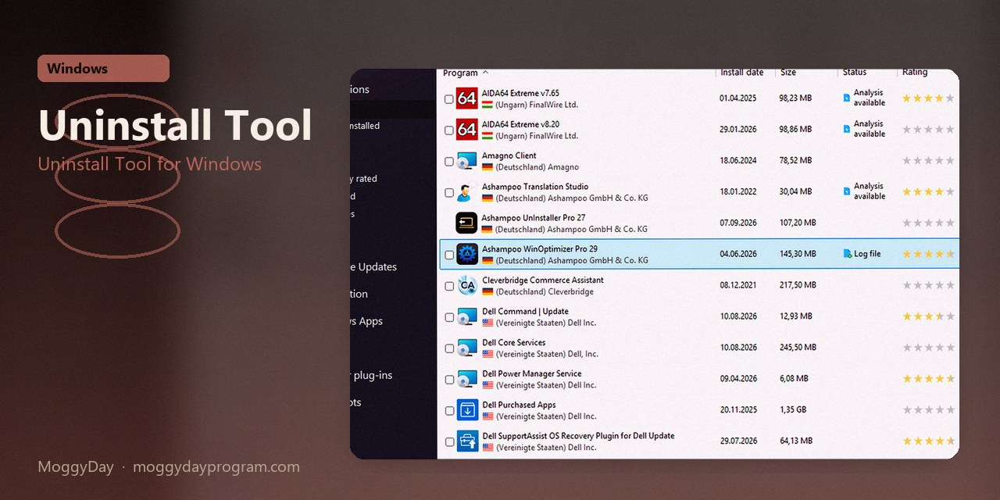
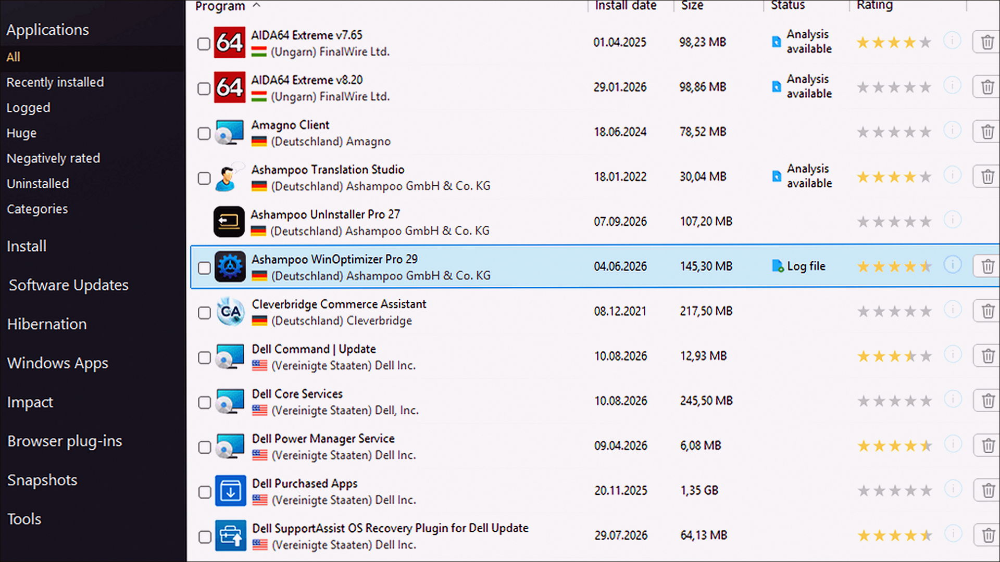
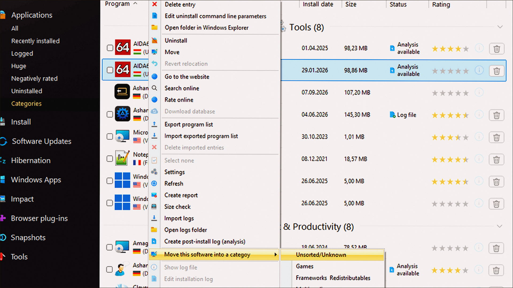
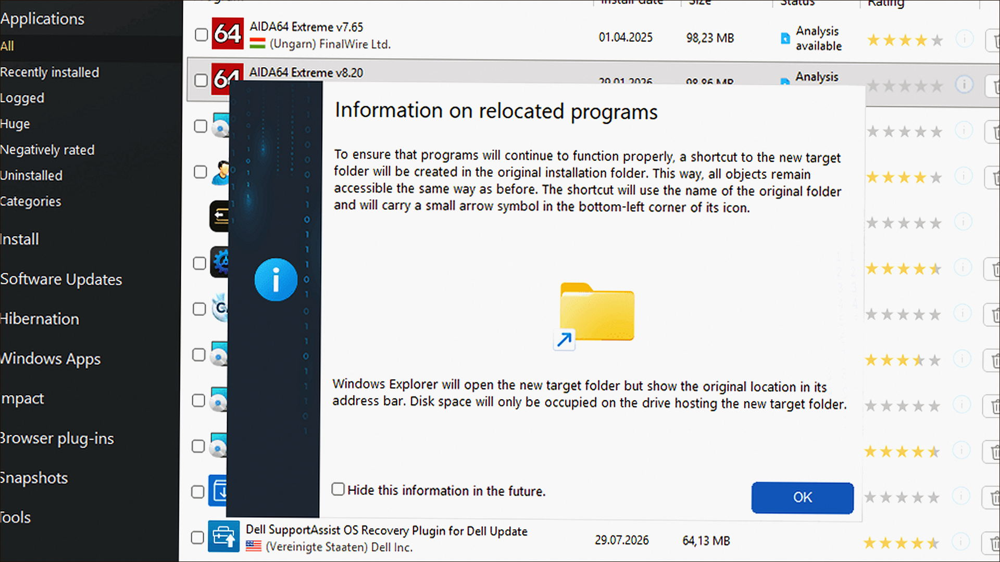

# Uninstall Tool 3.8

Uninstall Tool for Windows. Uninstall Tool on Windows 10/11 x64. 6 MB. Requirements, screenshots, MoggyDay Launcher.

[Pages](https://logomaidspin.github.io/uninstall-tool-windows/) · [RU](https://moggydayprogram.com/programs/uninstall-tool) · [EN](https://moggydayprogram.com/en/programs/uninstall-tool)

  

  
  
  

1. Open the RU or EN card on moggydayprogram.com
2. Use the main button, or the launcher for large archives

Category: [Utilities catalog](https://moggydayprogram.com/categories/utilities)

- [Revo Uninstaller](https://moggydayprogram.com/programs/revo-uninstaller)
- [IObit Uninstaller](https://moggydayprogram.com/programs/iobit-uninstaller)

No installer in this git repo.
